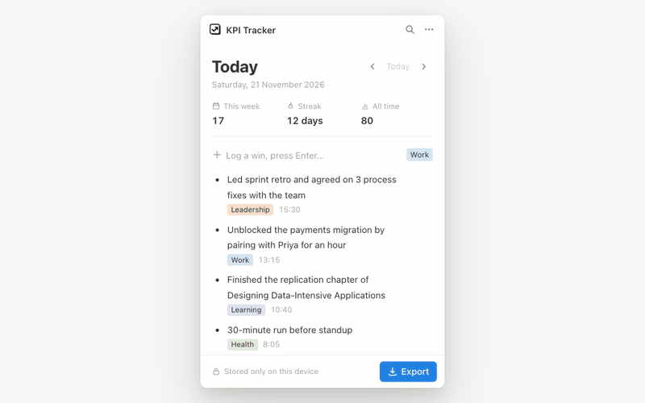
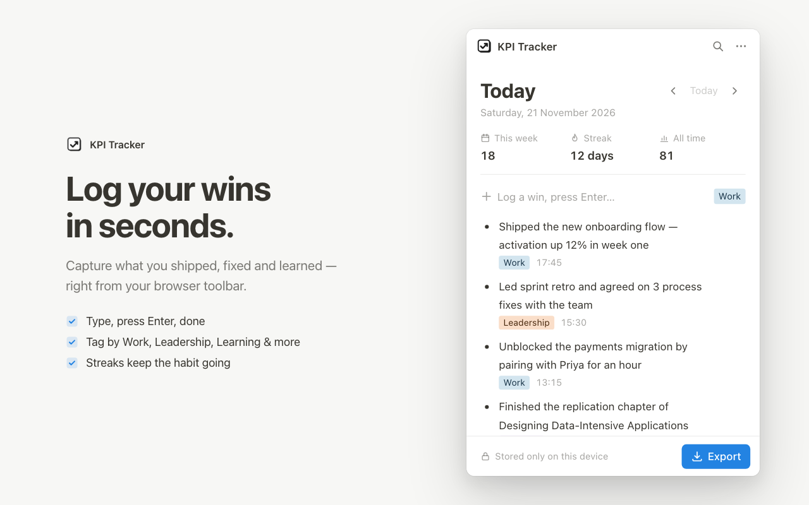
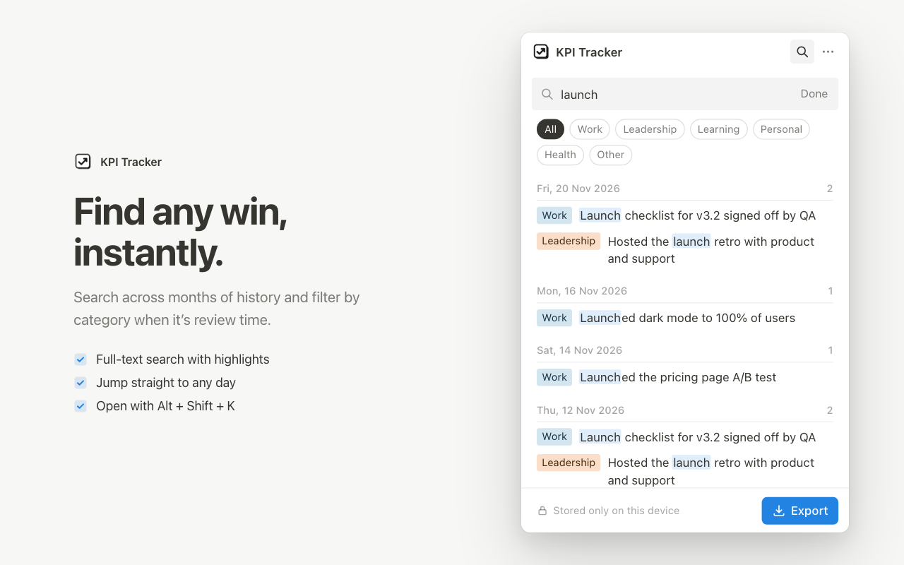
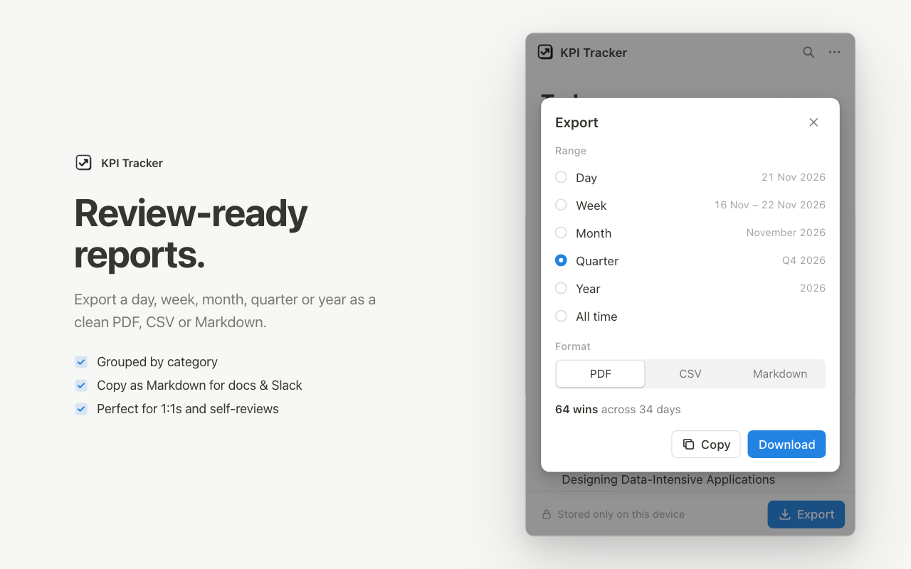
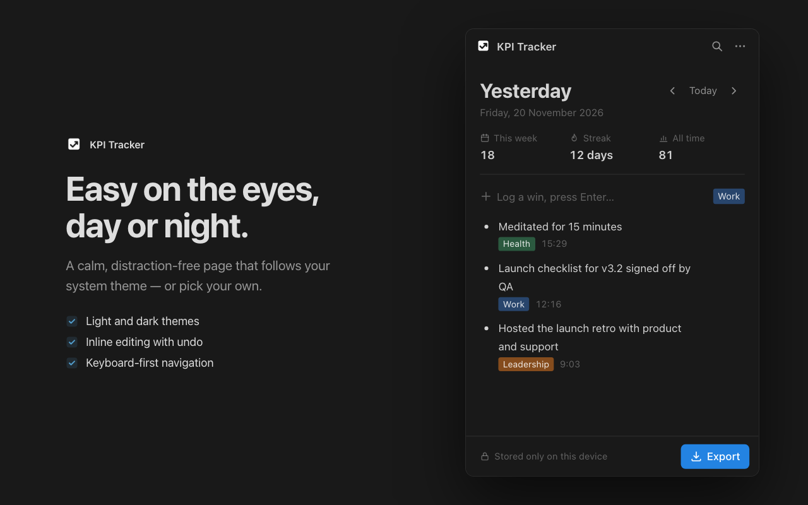
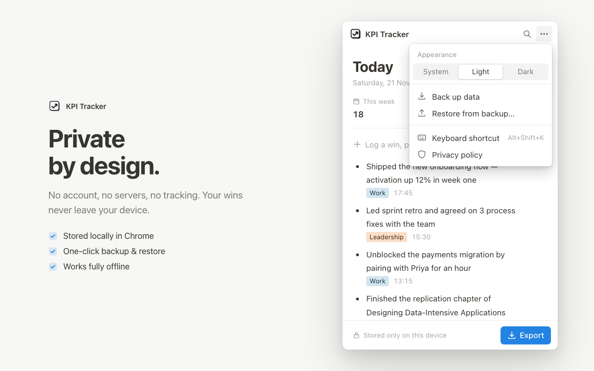

# KPI Tracker

A calm, minimalist Chrome extension for logging your daily wins and turning them into review-ready reports.

 

<p align="center">
  <a href="https://chromewebstore.google.com/detail/ajfoelcolcgemelfacofjbfbpcfkaloo"><b>Install from the Chrome Web Store</b></a>
</p>



## Features

- **Log in seconds**: type a win, press Enter. Tag it as Work, Leadership, Learning, Personal, Health or Other.
- **Edit inline**: click any entry to edit it, change its tag from the pill, and undo deletes.
- **Stats at a glance**: wins this week, your current streak, and your all-time total.
- **Search everything**: full-text search across your history with category filters. Click a result to jump to that day.
- **Reports**: export a day, week, month, quarter, year or all time as **PDF**, **CSV** or **Markdown**, or copy it as Markdown for docs, Slack and review forms.
- **Backup & restore**: download a JSON backup and restore it on any machine. Restores merge and never overwrite.
- **Light & dark**: follows your system theme, or you can pick one.
- **Keyboard-first**: `Alt+Shift+K` opens the popup, `/` opens search, `←`/`→` change day, `T` jumps to today, `N` focuses the input.
- **Private**: no account, no network requests, no analytics. Data lives in `chrome.storage.local`.

## Screenshots

| | |
| --- | --- |
|  |  |
|  |  |
|  | |

## Install (development)

1. Clone the repo: `git clone https://github.com/yesabhishek/kpi-tracker.git`
2. Open `chrome://extensions`, enable **Developer mode**.
3. Click **Load unpacked** and select the `kpi-tracker` folder.

## Project structure

```
manifest.json         Extension config (MV3, strict CSP, storage permission only)
popup.html/.css/.js   The whole app. No framework, no build step
libs/jspdf.umd.min.js jsPDF 4.2.1, lazy-loaded only when exporting a PDF
icons/                Toolbar and store icons (16/32/48/128)
docs/                 README demo GIF
store/                Chrome Web Store upload kit: zip, icons, screenshots, promo tiles, LISTING.md
tools/                Scripts to render icons and store assets and package the zip
```

## Releasing

```bash
./tools/package.sh         # -> store/package/kpi-tracker-<version>.zip (only runtime files)
./tools/render-icons.sh    # regenerate icons from tools/icon*.svg
./tools/render-store.sh    # regenerate store/ screenshots (needs Google Chrome)
```

Everything for the Chrome Web Store (zip, icon, screenshots, promo tiles and copy-paste listing text) is in [`store/`](store/LISTING.md). Follow [store/LISTING.md](store/LISTING.md) tab by tab.

**Privacy practices answers:** single purpose is "log personal achievements and export reports". The `storage` permission saves entries locally. No user data is collected or transmitted, and no remote code is used.

## Security notes

- Strict Content Security Policy: `script-src 'self'`, `connect-src 'none'`, `object-src 'none'`.
- All user text is rendered with `textContent`, never `innerHTML`.
- Backups are size-limited, schema-validated and sanitised before import.
- CSV exports neutralise spreadsheet formula injection.

## License

MIT
